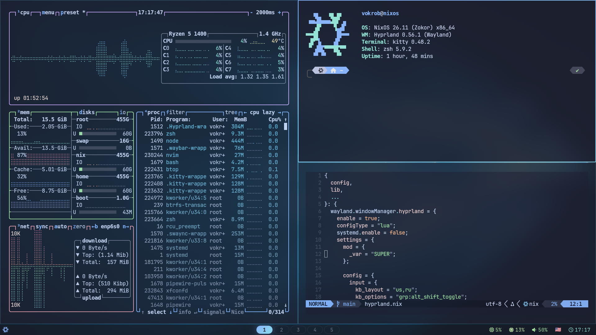

# NixOS + Hyprland



## Description

Personal NixOS setup built with Flakes and Home Manager, using Catppuccin Mocha, Hyprland,
OpenClaw, AmneziaWG, and gaming tools.

## Tech Stack

- NixOS, Flakes, Home Manager
- agenix, AmneziaWG
- Hyprland (Lua config), Catppuccin Mocha
- greetd, systemd-boot, zram swap
- Waybar, SwayNC, Kitty, Rofi, Thunar, fastfetch
- zsh + powerlevel10k, zoxide, fzf
- Steam, GameMode, Gamescope, MangoHud
- wakatime, Codestats, Gemini API keys
- nvim, opencode
- OpenClaw (Telegram gateway)
- Garnix cache, alejandra

## Installation

Requires x86_64 NixOS, sudo, an age key, and any recent Nix. Git is not needed
up front: the steps below pull it in via `nix shell`. Note that the config itself
does not install `git`, so after the first rebuild add `programs.git.enable = true;`
to `modules/nixos/base.nix`, or run `nix profile install nixpkgs#git`; otherwise
the `nix-switch`, `nix-commit` and `nix-log` aliases fail, since all three call
`git` on the repo.

Flakes must be enabled in `nix.conf` before the first command below; the config
itself sets `experimental-features` only after a successful rebuild.

```bash
echo 'experimental-features = nix-command flakes' | sudo tee -a /etc/nix/nix.conf
mkdir -p ~/.config/agenix && nix shell nixpkgs#age -c age-keygen -o ~/.config/agenix/age-key.txt
sudo mv /etc/nixos /etc/nixos.bak 2>/dev/null || true
nix shell nixpkgs#git -c git clone https://github.com/vokrob/nixos-config.git ~/nixos-config
nixos-generate-config --show-hardware-config > ~/nixos-config/hosts/nixos/hardware-configuration.nix
```

Every command below addresses the config by path (`--flake ~/nixos-config`), so
nothing needs to live in `/etc/nixos`; the old directory is only moved aside to
avoid confusion.

`.github/workflows/check.yml` runs `nix fmt -- --check .` and `nix flake check`
on every push and pull request. It creates placeholder files for the workspace
input before evaluating and overrides it on the command line. The path
`/home/vokrob` is hardcoded throughout that file, so replace it if you fork.

### Personalize

The repo ships with `vokrob` as the user name and a workspace path in the flake.
Replace them before the first rebuild:

| file | what to change |
|------|----------------|
| `flake.nix` | `openclaw-workspace.url` → `path:/home/<you>/.config/openclaw` |
| `flake.nix` | `nixosConfigurations.vokrob` is the output name. Rename it and update `#vokrob` in the rebuild command below and in the `nix-switch` alias (`modules/home/programs/zsh.nix:8`) |
| `flake.lock` | don't edit by hand; `nix flake update openclaw-workspace` below regenerates the path and its `narHash` together |
| `hosts/nixos/default.nix` | `networking.hostName`, `services.greetd...user`, `home-manager.users.<name>`, `nix.settings.trusted-users`, `time.timeZone` (currently `Asia/Barnaul`), and `services.udev.extraRules`, which holds this machine's disk UUIDs, delete or replace it |
| `hosts/nixos/users.nix` | `users.users."vokrob"` block, the `owner = "vokrob"` on each `age.secrets` entry, and `age.identityPaths` → `["/home/<you>/.config/agenix/age-key.txt"]` |
| `modules/nixos/base.nix` | `i18n.extraLocaleSettings` is set to `ru_RU.UTF-8` |
| `dotfiles/waybar/config.jsonc` | `clock.timezone` (currently `Asia/Barnaul`) and the device name in `custom/keyboard-layout.on-click`, which is this machine's Bluetooth keyboard |
| `modules/home/base.nix` | `home.username`, `home.homeDirectory`, and the absolute paths in `xdg.userDirs` |
| `modules/home/programs/firefox.nix` | `browser.download.dir` |
| `modules/home/features/hyprland.nix` | `config.input.kb_layout` is `us,ru` |
| `modules/home/features/openclaw.nix` | `allowFrom` Telegram IDs (in both `tools.elevated` and `channels.telegram`) |

`users.users."vokrob"` has no password set in the config, and `greetd`
authenticates through PAM, so set one before your first login, either add an
`initialPassword`/`hashedPassword` in `hosts/nixos/users.nix`, or run
`passwd vokrob` right after the first rebuild (it survives rebuilds, since
`users.mutableUsers` is on by default). `security.sudo.enable` is already `true`
by default in nixpkgs, so `sudo` works out of the box.

The wallpaper path is hardcoded in `modules/home/features/hyprland.nix`; put your
own image at `~/Pictures/desktop.jpg`. Note that `modules/home/base.nix` sets
`xdg.userDirs.createDirectories = false`, so `~/Downloads` and `~/Pictures` are
not created for you; make them yourself.

### OpenClaw workspace

The flake takes the workspace from a local path input; it must exist with these
five files or evaluation fails:

```bash
mkdir -p ~/.config/openclaw
for f in AGENTS.md SOUL.md TOOLS.md IDENTITY.md USER.md; do
  echo "# $f" > ~/.config/openclaw/$f
done
```

After editing them, refresh the lock for that input before rebuilding:

```bash
nix flake update openclaw-workspace --flake ~/nixos-config
```

### Secrets

`secrets/*.age` in the repo are encrypted to my key. Create your own values, drop
the shipped files, and re-encrypt all six entries listed in `secrets.nix`:

```bash
# agenix reads ./secrets.nix relative to the cwd, so run from the repo root
cd ~/nixos-config
grep -oP 'age1\w+' ~/.config/agenix/age-key.txt  # put this key into secrets.nix
rm -f secrets/*.age

# opens $EDITOR, type the value, save, and the file gets encrypted
nix run github:ryantm/agenix -- -e secrets/codestats-api-key.age
# repeat for the other five files
sudo nixos-rebuild switch --flake ~/nixos-config#vokrob
```

Without an interactive editor, pipe the value in: agenix reads stdin when it
is not a terminal:

```bash
printf '%s' 'YOUR_KEY' | nix run github:ryantm/agenix -- -e secrets/codestats-api-key.age
```

- `codestats-api-key`, `wakatime-api-key`, `gemini-api-key`: third-party API keys
- `openclaw-telegram-token`: bot token from @BotFather
- `openclaw-gateway-token`: any random string you generate
- `amneziawg-awg0`: a full `awg-quick` config for your tunnel

## Usage

| alias        | what it does                       |
|--------------|------------------------------------|
| `nix-switch` | update the workspace lock, stage changes, rebuild |
| `nix-commit` | stage changes and commit           |
| `nix-log`    | show the commit graph              |
| `v`          | open nvim                          |

`rec-toggle {full,region,window,stop}` wraps wf-recorder: `Scroll_Lock` (region),
`mod + Scroll_Lock` (window), `mod + SHIFT + Scroll_Lock` (full), `Pause` (stop).

Print takes screenshots through grim instead: `PRINT` (area), `mod + PRINT`
(active window), `mod + SHIFT + PRINT` (full screen), each copied to the clipboard.
